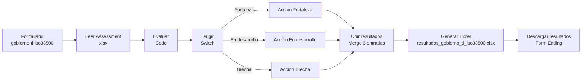

# Evaluación de madurez — ISO/IEC 38500:2024

## 1. Qué es

`flujo-gobierno-ti-iso38500` es un workflow de **n8n** que recibe un libro de
Excel con la autoevaluación de madurez, calcula el cumplimiento por principio de
la ISO/IEC 38500:2024 y genera un Excel con los resultados y la acción sugerida
para cada principio.

Es complementario al dashboard, no forma parte de él:

| Aspecto | Dashboard `dashboard_ISO38500` | Evaluación de madurez |
|---|---|---|
| Entrada | `Extraido_CIO_Completo.xlsx` (Google Drive o copia local) | Excel de assessment subido por formulario |
| Proceso | Limpieza, cálculo de KPIs y renderizado en Streamlit | Agrupación por principio, puntaje y nivel de madurez |
| Salida | Dashboard interactivo en el navegador | `resultados_gobierno_ti_iso38500.xlsx` |
| Usuario | Consulta y exploración | Diligenciamiento de la evaluación |
| Persistencia | Ninguna; lee en cada ejecución | Solo la ejecución de n8n y el archivo descargado |

> El Excel del dashboard **no** contiene la hoja `Assessment` que espera este
> flujo. Son dos libros distintos: uno es el inventario institucional y el otro
> es el cuestionario de madurez.

## 2. Flujo



El nodo **Descargar resultados** está en la copia versionada del flujo. En el
export original el flujo terminaba en **Generar Excel**, por lo que el
formulario no devolvía el archivo al usuario.

## 3. Nodos

| Nodo | Tipo | Función |
|---|---|---|
| `Cargar Excel` | Form Trigger | Publica el formulario y recibe el archivo |
| `Leer Assessment` | Extract From File | Lee la hoja `Assessment` sin fila de encabezado |
| `Evaluar` | Code | Agrupa por principio y calcula puntos, porcentaje y nivel |
| `Dirigir` | Switch | Clasifica cada principio según `lectura` |
| `Acción Fortaleza` | Set | Agrega la acción para los principios ≥ 70 % |
| `Acción En desarrollo` | Set | Agrega la acción para los principios entre 40 % y 69,9 % |
| `Acción Brecha` | Set | Agrega la acción para los principios < 40 % |
| `Unir resultados` | Merge (3 entradas) | Vuelve a unir las tres ramas |
| `Generar Excel de resultados` | Convert To File | Crea el `.xlsx` de salida |
| `Descargar resultados` | Form Ending | Devuelve el archivo al navegador |

## 4. Entrada

### 4.1 Formulario

| Elemento | Valor |
|---|---|
| Ruta | `gobierno-ti-iso38500` |
| Título | Evaluación de madurez de Gobierno de TI |
| Campo | `archivo` (un solo archivo, obligatorio) |
| Tipos aceptados | `.xlsx` |

Las URLs de prueba y producción no se documentan porque dependen de la
instancia donde se importe el flujo. n8n las genera a partir de la ruta
`gobierno-ti-iso38500` y las muestra en el nodo **Cargar Excel** después de
importar el `.json`.

### 4.2 Libro de Excel

- Debe existir una hoja llamada exactamente **`Assessment`**.
- No se usa la fila de encabezado (`headerRow: false`); el flujo busca patrones
  en cualquier celda de cada fila.
- Cada fila debe contener:
  - una celda con la etiqueta `[ISO 38500 – Principio]` (guion o en dash);
  - una celda con el estado: `Sí`, `Parcial` o `No`.

Ejemplo:

| Etiqueta | Pregunta | Respuesta |
|---|---|---|
| `[ISO 38500 – Propósito]` | ¿El directorio aprueba el plan de TI? | `Sí` |
| `[ISO 38500 – Propósito]` | ¿Se revisa el alineamiento cada año? | `Parcial` |
| `[ISO 38500 – Riesgo]` | ¿Existe un comité de riesgos de TI? | `No` |

Reglas de lectura:

- La etiqueta debe empezar la celda y tener el formato `[ISO 38500 – ...]`.
- El estado se compara sin mayúsculas ni tildes (`Sí` = `si`).
- Si una fila no tiene etiqueta o estado, se ignora.
- Si una fila tiene varias celdas de estado, se usa la primera.
- El nombre del principio es el texto que queda dentro de los corchetes; el
  flujo no valida que sean los 11 principios de la norma.

## 5. Cálculo

### 5.1 Puntaje

| Respuesta | Puntos |
|---|---:|
| `Sí` | 2 |
| `Parcial` | 1 |
| `No` | 0 |

Cada pregunta vale 2 puntos. Para cada principio:

```text
porcentaje = puntos del principio / (2 × número de preguntas) × 100
```

### 5.2 Lectura por principio

| Porcentaje | Lectura |
|---|---|
| ≥ 70 % | Fortaleza |
| ≥ 40 % y < 70 % | En desarrollo |
| < 40 % | Brecha |

El cálculo usa la proporción sin redondear; el porcentaje que se muestra sí se
redondea a un decimal.

### 5.3 Nivel global

```text
porcentaje_global = suma de puntos / suma de máximos × 100
```

| Porcentaje global | Nivel |
|---|---|
| ≥ 85,7 % | Nivel 5 — Optimizado |
| ≥ 71,4 % | Nivel 4 — Cuantitativo |
| ≥ 57,1 % | Nivel 3 — Definido |
| ≥ 42,8 % | Nivel 2 — Gestionado |
| ≥ 28,5 % | Nivel 1 — Inicial |
| < 28,5 % | Nivel 0 — Incompleto |

### 5.4 Acción sugerida

| Lectura | Acción |
|---|---|
| Fortaleza | Mantener y documentar buenas prácticas |
| En desarrollo | Formalizar y estandarizar procesos |
| Brecha | Prioridad alta: plan de mejora con responsables y KPI |

## 6. Salida

Archivo: `resultados_gobierno_ti_iso38500.xlsx`, hoja `Resultados`.

Una fila por principio, con estas columnas:

| Columna | Contenido |
|---|---|
| `principio` | Nombre tomado de la etiqueta |
| `preguntas` | Número de preguntas del principio |
| `puntos` | Puntos obtenidos |
| `maximo` | Puntos posibles |
| `porcentaje` | Porcentaje del principio (un decimal) |
| `lectura` | Fortaleza / En desarrollo / Brecha |
| `puntos_totales` | Puntos de todos los principios |
| `maximo_total` | Puntos posibles de todos los principios |
| `porcentaje_global` | Porcentaje global (un decimal) |
| `nivel` | Nivel 0 a 5 con su nombre |
| `accion` | Acción sugerida |

Los campos globales (`puntos_totales`, `maximo_total`, `porcentaje_global`,
`nivel`) se repiten en cada fila. El archivo no incluye una fila de total
independiente.

## 7. Puesta en marcha

1. Importar `n8n/flujo-gobierno-ti-iso38500.json` en n8n:
   **Workflows → Add workflow → ⋯ → Import from File**.
2. Guardar y revisar el nodo **Cargar Excel**.
3. Activar o publicar el workflow.
4. Copiar la URL de producción que muestra el nodo y abrirla.
5. Subir el Excel, enviar y descargar el resultado.

El flujo no requiere credenciales: todos los nodos son core de n8n. Se necesita
una versión reciente de n8n que soporte Form Trigger 2.6 y Form Ending con
`Return Binary File`.

La copia versionada tiene `active: false` para que no se publique sola al
importarla.

## 8. Seguridad y tratamiento de datos

- El formulario queda **público por defecto**: cualquiera con la URL puede subir
  un archivo. Configurar **Authentication → Basic Auth** o **n8n User Auth** en
  el nodo `Cargar Excel`.
- El Excel se almacena en los datos de ejecución de n8n. Configurar la purga
  (`EXECUTIONS_DATA_PRUNE`, `EXECUTIONS_DATA_MAX_AGE`) o borrar ejecuciones
  periódicamente.
- Publicar solo con HTTPS y, si es self-hosted, detrás de un proxy; no exponer
  el puerto 5678 directamente a internet.
- No usar una instancia pública de prueba con información real del banco.
- El flujo no escribe en Google Drive ni en el Excel de entrada; solo lee el
  archivo subido y genera uno nuevo.

## 9. Limitaciones conocidas

| Limitación | Efecto | Mitigación |
|---|---|---|
| El export original no tenía Form Ending | El navegador no descargaba el Excel | Usar la copia con `Descargar resultados` |
| Si ninguna fila coincide, `maximo_total` es 0 | División por cero y error en `nivel` | Validar el Excel antes de enviarlo |
| `Unir resultados` espera tres ramas | Si una categoría queda vacía, la ejecución puede quedarse esperando | Reemplazar Switch + 3 Set + Merge por un solo nodo Code |
| Pesos fijos 2/1/0 | No se puede ponderar por criticidad | Ajustar el objeto `PTS` del nodo `Evaluar` |
| No valida el nombre de la hoja | Un libro sin `Assessment` falla al leer | Verificar la hoja antes de subir |
| Sin autenticación por defecto | Cualquiera con el enlace puede subir archivos | Activar Basic Auth o n8n User Auth |
| Sin historial propio | Cada envío es independiente; no hay base de datos | Guardar los resultados en Drive, correo o base de datos |

## 10. Relación con el versionado

La automatización se versiona junto con el repositorio. El archivo exportado
está en:

```text
n8n/flujo-gobierno-ti-iso38500.json
```

Es la copia con el nodo **Descargar resultados**. El export original no se
versionó porque no devolvía el archivo al usuario. Cualquier cambio en los
umbrales, los pesos o las acciones debe reflejarse en este documento y en el
`CHANGELOG.md`.
