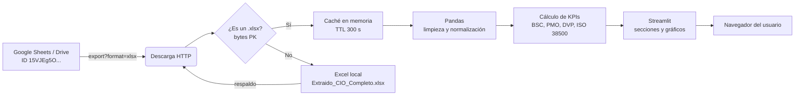
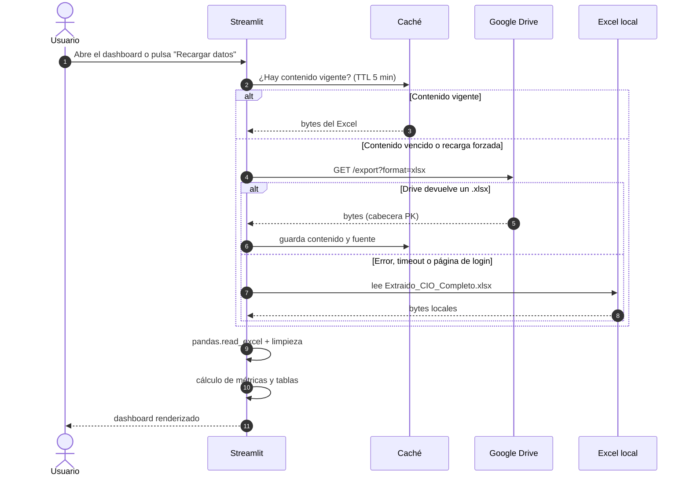

# Flujo automatizado y arquitectura — Dashboard ISO/IEC 38500:2024

## 1. Resumen

`dashboard_ISO38500` es una aplicación de **Streamlit** que lee un libro de Excel
(`Extraido_CIO_Completo.xlsx`) publicado en Google Drive. No hay base de datos ni
proceso de ETL programado: la automatización es **pull-based**, es decir, cada
vez que un usuario abre o recarga el dashboard, la aplicación descarga el Excel,
lo limpia con Pandas, calcula los indicadores y renderiza las secciones.



## 2. Diagrama de secuencia



## 3. Fuente de datos

| Elemento | Valor |
|---|---|
| Archivo | `Extraido_CIO_Completo.xlsx` |
| ID de Google Drive | `15VJEg5OykTfv99NhHynsoqQfdea0ij2m` |
| URLs intentadas | `docs.google.com/spreadsheets/d/{ID}/export?format=xlsx` y `drive.google.com/uc?export=download&id={ID}` |
| Requisito de compartir | "Cualquier persona con el enlace" (lectura) |
| Respaldo | `dashboard_ISO38500/Extraido_CIO_Completo.xlsx` |
| Frecuencia de refresco | 5 minutos (`ttl=300`) o botón **Recargar datos** |

La aplicación verifica que la respuesta empiece por `PK`, que es la firma de un
archivo `.xlsx` (los `.xlsx` son archivos ZIP). Si Drive devuelve una página de
inicio de sesión o un error HTML, la descarga se descarta y se usa el respaldo
local.

## 4. Flujo de ejecución

### 4.1 Carga

1. `cargar_excel()` intenta las dos URLs de Drive con timeout de 20 segundos.
2. Si obtiene un `.xlsx`, devuelve `(contenido, "Google Drive")`.
3. Si no, lee `Extraido_CIO_Completo.xlsx` y devuelve `(contenido, "Excel local")`.
4. `leer_hojas(contenido)` lee **todas** las hojas con
   `pd.read_excel(..., sheet_name=None)`, elimina columnas `Unnamed`, recorta
   espacios de los encabezados y elimina filas vacías.
5. `hoja(nombre)` devuelve la hoja descargada; si no existe en Drive, intenta la
   copia local.

### 4.2 Preparación de datos

El bloque de preparación (antes de la barra lateral) construye las tablas que
usan todas las secciones:

| Tabla | Origen | Propósito |
|---|---|---|
| `presupuesto` | `Presupuesto proyect` | Presupuesto por tipo de iniciativa y año |
| `bsc` | `BSC` | Indicadores, actual, meta y % de cumplimiento |
| `gobierno_datos` | `Inventario Datos` (opcional) | Activos de datos, responsables, calidad |
| `gobierno_ia` | `Inventario IA` (opcional) | Casos de uso de IA, ética y monitoreo |
| `operacion` | `Operacion TI` (opcional) | Solicitudes de mesa de servicio por mes |
| `dvp` | `Detalle iniciativa DVP` | Iniciativas de transformación digital |
| `pmo` | `Detalle iniciativa pmo` + `Iniciativas` | Proyectos PMO y retraso frente a línea base |
| `maestra` | `MAESTRA_INICIATIVAS` | Portafolio completo por tipo y dominio |
| `iniciativas_datos` | `Gobierno de Datos` o búsqueda por palabras clave | Iniciativas de datos |
| `iniciativas_ia` | `Gobierno IA` o búsqueda por palabras clave | Iniciativas de IA y automatización |
| `metricas_iso` / `iso` | Cálculo o hoja `ISO 38500` | Métricas de los principios ISO |
| `evaluacion_iso` | `ISO 38500 Evaluacion` | Evidencia de los 16 puntos de la sección 4.1 |
| `riesgos` | `Riesgos` | Matriz de riesgos por frente e impacto |
| `arquitectura` | `Arquitectura tecnologica` | Inventario tecnológico |

### 4.3 Reglas de precedencia

El dashboard prefiere la información más específica que exista en el Excel:

| Información | Primero usa | Si no existe, usa |
|---|---|---|
| Métricas ISO | Hoja `ISO 38500` (columnas `Principio`, `Actual`, `Meta`, `Menor es mejor`) | Métricas calculadas con BSC, PMO, maestra e inventarios |
| Iniciativas de datos | Hoja `Gobierno de Datos` (columna `Tipo de registro`) | Búsqueda por palabras clave en DVP y PMO |
| Iniciativas de IA | Hoja `Gobierno IA` (columna `Hoja de origen`) | Búsqueda por palabras clave en DVP y PMO |
| Evaluación ISO | Hoja `ISO 38500 Evaluacion` | No se muestra la evaluación |
| Plan de acción | Hoja `Plan de accion` | Plan generado desde los principios sin datos |
| Inventario de datos | Hoja `Inventario Datos` | Sección vacía / pendiente |
| Inventario de IA | Hoja `Inventario IA` | Sección vacía / pendiente |
| Operación TI | Hoja `Operacion TI` | Sección vacía / pendiente |

Esta precedencia permite que el banco empiece con datos incompletos y vaya
reemplazando cálculos automáticos por datos oficiales sin cambiar el código.

### 4.4 Renderizado

1. La barra lateral fija la entidad (`Banco Unión`) y un `st.sidebar.radio` con
   11 secciones.
2. Cada sección se ejecuta en un `if/elif` y solo se renderiza la seleccionada.
3. **Recargar datos** limpia `st.cache_data` y vuelve a ejecutar la app.
4. La fuente real (`Google Drive` o `Excel local`) y la versión se muestran en
   la barra lateral.

Secciones: Resumen, ISO 38500, Gobierno de Datos, Gobierno de IA, Operación TI,
BSC, Portafolio, Innovación, Riesgos, Arquitectura y Contexto.

## 5. Despliegue

### Streamlit Community Cloud

- El repositorio se conecta a Streamlit Community Cloud.
- `.streamlit/config.toml` (raíz) define tema claro y desactiva estadísticas de uso.
- `dashboard_ISO38500/requirements.txt` fija versiones mínimas:
  `streamlit>=1.67.0`, `pandas>=3.1.1`, `openpyxl>=3.1.5`,
  `matplotlib>=3.11.2`, `seaborn>=0.13.2`.
- Para publicar, el archivo principal debe ser `dashboard_ISO38500/app.py` y el
  Excel debe seguir accesible por enlace.

### Ejecución local

```powershell
cd dashboard_ISO38500
python -m streamlit run app.py
```

o doble clic en `iniciar.bat`. El `.bat` intenta primero `python` y, si falla,
usa `%LOCALAPPDATA%\Programs\Python\Python312\python.exe`.

## 6. Modos de falla y comportamiento esperado

| Situación | Comportamiento | Dónde se ve |
|---|---|---|
| Sin internet | Usa el Excel local | Barra lateral: "Fuente de datos: Excel local" |
| Drive no público | La respuesta no empieza por `PK`; usa el Excel local | Barra lateral |
| Timeout de Drive | Igual que el caso anterior | Barra lateral |
| Hoja opcional ausente | Se muestra vacía o "pendiente"; no se inventan datos | Sección correspondiente |
| Hoja obligatoria ausente | `KeyError` y la app se detiene | Log de Streamlit |
| Columna obligatoria renombrada | `KeyError` en la sección que la usa | Log de Streamlit |
| Copia local desactualizada | Se muestra la fuente "Excel local" | Barra lateral |

## 7. Seguridad y tratamiento de datos

- La aplicación es de **solo lectura**: no escribe en Google Drive ni en el Excel.
- No hay credenciales ni tokens en el repositorio; el acceso depende de que el
  enlace sea público para lectura.
- El repositorio incluye un libro de Excel con información interna del banco.
  **Antes de publicar el repositorio, verifique si es público**; si lo es,
  considere mover el Excel a almacenamiento privado o usar datos anonimizados.
- Los logs de Streamlit pueden incluir nombres de columnas y errores, pero no
  contraseñas.

## 8. Runbook operativo

### Actualizar los datos

1. Editar el Google Sheet (no cambiar nombres de hojas ni de columnas).
2. Esperar hasta 5 minutos o pulsar **Recargar datos**.
3. Verificar en la barra lateral que la fuente sea "Google Drive".

### Publicar un cambio de código

1. Crear una rama: `git switch -c feat/mi-cambio`.
2. Hacer el cambio y probar en local.
3. Actualizar `CHANGELOG.md` y, si aplica, la versión.
4. `git add`, `git commit`, `git push`.
5. Abrir Pull Request y revisar el despliegue de Streamlit Cloud.

### Agregar una hoja nueva

1. Crear la hoja en el Excel con encabezados en la fila 1.
2. Agregar el nombre exacto en el código (`hoja("Nombre exacto")`).
3. Si es opcional, usar `hoja_opcional(...)` o `hoja_si_existe(...)`.
4. Documentar el contrato en [CONTRATO_DATOS.md](CONTRATO_DATOS.md).
5. Probar con la hoja vacía y con datos.

## 9. Limitaciones conocidas

- No hay pruebas automatizadas ni integración continua.
- El cálculo de cumplimiento asume que la meta no es cero; una meta en cero
  produce división por cero en `cumplimiento()`.
- `app.py` es un script largo (más de 1.000 líneas); las secciones están
  separadas por comentarios, no por módulos.
- La función `pendiente()` existe pero no se usa actualmente.
- `leer_hoja_local()` se cachea sin TTL ni clave de fecha; si cambia el Excel
  local, puede mostrar la versión anterior hasta limpiar la caché.
- El README original listaba una sección "Calidad de datos" que no existe en la
  aplicación; fue corregido en esta revisión.
